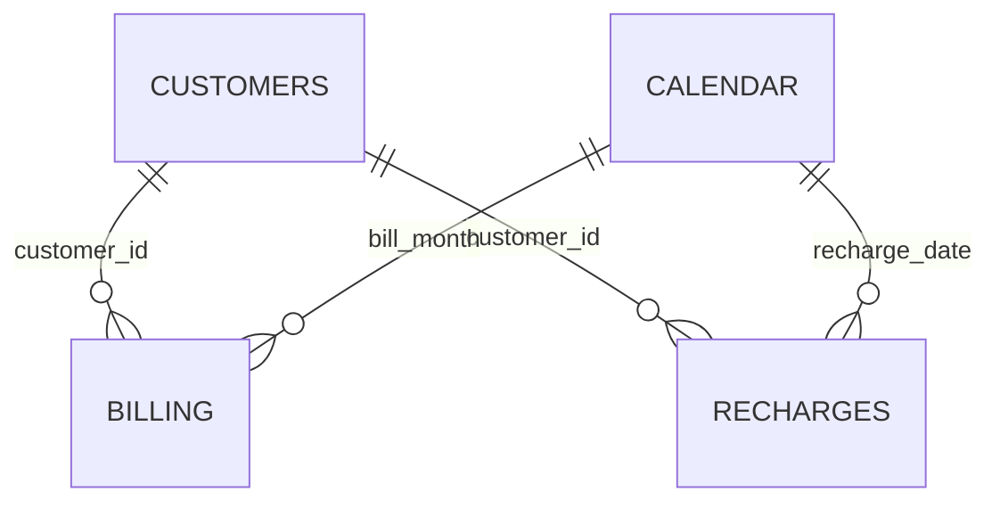

# Revenue and Recharge Performance Dashboard

SQL · Power BI DAX · Excel

A telecom analytics portfolio project combining customer, billing, and recharge data. The reporting model tracks billed revenue, ARPU, recharge success, and monthly revenue growth, with regional comparisons and a documented Power BI drill-down workflow.

**Data is entirely synthetic**, generated with seed 42 for January–December 2025. No customer information or business results are real. Currency is INR. The dashboard image is rendered from the included Excel workbook, not captured from Power BI. Power BI DAX and setup instructions are provided; a native PBIX is not included.


## Business questions

- How does billed revenue change month to month?
- How much billed revenue is earned per customer-month?
- What proportion of recharge attempts succeed?
- How does performance differ by region, plan type, and customer segment?

## Repository files

| File | Purpose |
| --- | --- |
| `Revenue_Recharge_Dashboard.xlsx` | Editable Excel dashboard, region selector, formula-driven monthly KPIs, native charts, and source tables |
| `images/dashboard.png` | Dashboard preview for this README |
| `data/customers.csv` | 600 customer dimension records |
| `data/billing.csv` | 5,800 customer-month billing records |
| `data/recharges.csv` | 11,718 recharge attempts |
| `data/telecom.db` | Ready-to-query SQLite database with reporting views |
| `sql/01_schema.sql` | Tables, keys, and constraints |
| `sql/02_analysis.sql` | Monthly KPI and revenue drill-down views |
| `powerbi/measures.dax` | Date table and report measures |
| `powerbi/SETUP.md` | Relationships, visuals, slicers, drill-down and validation instructions |
| `scripts/generate_data.py` | Reproducible synthetic-data and database generator |

## KPI definitions

| KPI | Definition |
| --- | --- |
| Revenue | Sum of billed charges, excluding any assumed taxes, refunds or credits |
| Billed customers | Distinct customers with a bill in a month |
| ARPU | Revenue / billed customer-months. For one month this equals revenue / billed customers |
| Recharge success rate | Successful recharge attempts / all recharge attempts, including retries |
| Recharge collections | Amount of successful recharge attempts only |
| MoM revenue growth | Current monthly revenue / prior monthly revenue − 1. January is blank |

Billing represents an illustrative charge ledger for both plan types. Recharge represents wallet funding attempts for both plan types. Recharge collections are a separate cash metric and **must not be added to billed revenue**. This is a simplified analytical model, not an accounting revenue recognition model. No usage data is supplied.

## Data model and grain



`customers` has one row per customer with stable region, plan and segment. `billing` has exactly one row per billed customer-month; the unique key is `(customer_id, bill_month)`. `recharges` has one row per attempt, including failed attempts. Power BI's calendar has one row per day. Monthly facts use the first day of each month.

Facts are aggregated independently before joining monthly totals. Joining both fact tables directly on customer would multiply rows and inflate revenue. Excel source sheets add customer attributes through a static key-based enrichment. Power BI uses the original normalized CSVs and dimension relationships.

## Open and explore

Open the Excel workbook and change **Dashboard!C5** to filter the headline KPIs and monthly trends by region. Headline cards show December 2025. The regional comparison always shows full-year totals for all regions. Source tables support ordinary Excel filtering. The workbook has no macros and no external refresh connections. Its source formulas use the supplied, bounded row ranges; extending the dataset requires extending those ranges. Plan and segment drill-down is described for Power BI in [SETUP.md](powerbi/SETUP.md).

## Run the SQL

The supplied database is ready to query with SQLite 3.25 or later:

```bash
sqlite3 data/telecom.db "SELECT * FROM monthly_kpis;"
sqlite3 data/telecom.db "SELECT * FROM revenue_drilldown WHERE region='South';"
```

To rebuild from CSV with the SQLite CLI, start a new database, then run:

```text
.read sql/01_schema.sql
.mode csv
.import --skip 1 data/customers.csv customers
.import --skip 1 data/billing.csv billing
.import --skip 1 data/recharges.csv recharges
.read sql/02_analysis.sql
SELECT * FROM monthly_kpis;
```

These scripts target SQLite; date grouping syntax requires adaptation for SQL Server or PostgreSQL. To regenerate identical data, run `python scripts/generate_data.py` from the repository root. This replaces the CSVs and SQLite database; it does not refresh the workbook or image. The generator uses Python's standard library.

## Validation and example findings

SQL revenue, recharge counts, and successful attempts reconcile to the generated source records. December has revenue **INR 237,919.02**, **600** billed customers, **INR 396.53** ARPU, **1,223** recharge attempts, **94.60%** recharge success, and **1.93%** MoM revenue growth.

The simulation intentionally expands the billed population early in the year and increases charges and recharge success probability through the year. These trends demonstrate analysis techniques; they are not evidence of real commercial impact. Region, plan, and segment are static, and no churn, refunds, taxes, invoice payment status or usage behavior is modeled. Every failed attempt remains a failed attempt even if a later attempt succeeds.

The Excel file was calculated and visually reviewed with the authoring engine. Power BI measures and configuration are supplied for implementation and have not been executed in Power BI Desktop.

## Publish to GitHub

Extract the project ZIP and upload **the contents of `revenue-recharge-project`** to a new repository. Keep the `images` folder beside `README.md` so the preview renders. Suggested repository name: `revenue-recharge-performance-dashboard`. Add your completed PBIX after following the setup guide.
